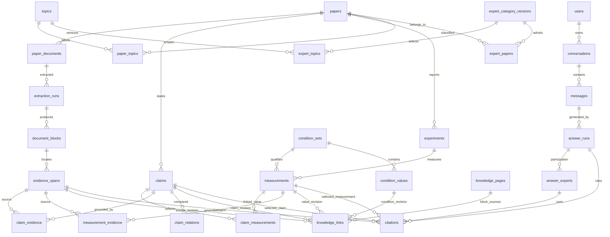

# Evidence Studio DB 설계 기준

> **연구 QA 후속 구현:** 기본·심층 질의, 원천 근거 확장, 종합 판단과 진술 검토, 본인 전용 답변 snapshot을 적용했다. 현재 범위는 [연구 QA](RESEARCH_QA.md)를 우선하며, 이 문서의 PostgreSQL·원천 revision 설계 전체를 구현한 것은 아니다.

> **2026-10-13 최신 구현:** 실제 Markdown Wiki·공통 지식 재사용·범위 제한 검색·주기적 lint를 적용했습니다. 현재 실행 방식과 남은 사내 검증 항목은 [Markdown Wiki 운영 안내](MARKDOWN_WIKI.md)를 우선합니다. 아래의 Wiki 엔진/답변 검색이 미구현이라는 설명은 이전 단계의 기록입니다.


사내 후속 구현을 위한 PostgreSQL 합의안입니다. 기존 목업은 가상 데이터를 사용합니다. 사용자의 추가 요청으로 실제 PDF·SQLite·FTS5와 claim·수치·Wiki를 연결한 [로컬 시범](LOCAL_PILOT.md)을 구현했습니다. 해당 [SQLite DDL](../backend/pilot_schema.sql)은 아래 전체 운영 설계의 일부입니다. embedding 기반 문맥 분할·호출부·캐시는 구현했으며 사내 모델 실행은 아직 하지 않았습니다. LLM·답변용 vector 검색·SSO와 운영용 revision 시스템은 후속 범위입니다.

2026년 10월 12일 보완 합의: `claim_measurements` 다대다 연결, `knowledge_links`의 수치·조건 참조, 질문별 claim 선택, 사용 근거의 immutable revision 보존을 아래 설계에 반영했습니다. 기존 공통 논문 DB와 전문가의 담당 논문 경계는 유지합니다. 운영용 PostgreSQL DDL·마이그레이션은 사내 구현 범위입니다. 로컬 시범의 Wiki는 claim 링크를 통해 연결된 수치와 조건을 조회합니다.

## 저장 방식과 범위

**공통·특화 Wiki 보완 설계:** 논문·claim·수치의 기존 DB는 유지한다. 운영 Wiki에는 `scope=common|expert`와 `owner_expert_id`를 두고 공통 페이지의 owner는 NULL, 특화 페이지는 전문가 ID가 필수인 제약을 적용한다. 최초 작성자와 소유자는 별도 필드로 취급한다. 공통 페이지는 여러 전문가가 범위에 맞게 재사용하고 특화 페이지는 한 전문가가 소유한다. 페이지/블록의 근거 claim revision과 참조한 공통 Wiki revision을 의존 관계로 저장하여 변경분만 갱신한다. 전문가 삭제는 해당 특화 페이지·연결·갱신 대상을 함께 삭제/보관하고 공통 페이지에는 전파하지 않는다. 순환 Wiki 참조를 최종 근거로 삼지 않으며 원문까지의 경로를 보장한다. 이 확장은 설계이며 현재 SQLite에 별도 특화 Wiki를 생성하는 엔진은 없다. 상세 기준은 [전문가 지식 설계](EXPERT_KNOWLEDGE_PLAN.md)를 따른다.

**로컬 전문가 삭제 구현:** `expert_deletions(expert_id, deleted_at)`로 논리 삭제한다. 관리자 DELETE 요청은 현재 설정 revision을 검사한 뒤 설정 목록·추천·검색 대상에서 제외하고 `expert_knowledge_pages` 연결을 해제한다. 공통 Wiki·근거 원본·과거 작성 분야는 보존하며 설정·담당 논문은 실행 취소용으로 보관한다. 재시작과 새 논문 적재가 삭제를 되돌리지 않도록 모든 활성 조회와 정책 적용에서 삭제 상태를 검사한다. 복원 요청은 삭제 시각이 일치할 때만 처리하며 활성 전문가와 이름이 충돌하면 409로 거부한다. 현재 UI의 실행 취소는 마지막 삭제 알림이 남아 있는 세션에서 제공한다.

로컬 전문가 설정 편집: `GET /api/pilot/experts/{id}`가 저장된 설정과 hash revision을 반환하고 `PUT`은 동일 ID의 개요·분류·수동 편입/제외·활성 여부를 변경한다. 요청별 관리자 역할을 검사하며 최신 설정과 revision이 다르면 409로 거부한다. 하나의 트랜잭션 안에서 담당 논문과 공통 Wiki 연결을 갱신한다. 기존 분류 선택 기록이 없는 전문가는 현재 담당 논문을 직접 편입으로 보존해 표시하고 저장 시 정책으로 전환한다. 과거에 없던 초기 선택값을 추정하지 않으며 조회·취소는 정책을 변경하지 않는다. 별도의 과거 버전 열람·복원 이력은 아직 구현하지 않았다.

2026-10-13 후속 로컬 구현: `paper_classifications(paper_id, facets_json, fingerprint, method)`에 5축 분류 캐시를, `expert_policies(expert_id, policy_json, enabled, created_at)`에 신규 전문가의 분류 조합과 수동 편입·제외를 저장한다. 공통 분류 정의는 `shared/expert_facets.json`이며 라이브러리 필터와 전문가 구성에 함께 쓴다. 메모리 종류는 제목, 나머지는 제목·초록 규칙으로 판정하므로 전체 Report AI 엔진이나 LLM 수준의 정확도를 의미하지 않는다. 분류가 확인되지 않은 제한 축은 검토 대기로 두며, 기존 PDF를 다시 분석하지 않는다. 서버 시작·새 PDF 적재·근거 적재 완료 시 저장 정책을 재적용하고 `expert_papers` 및 `expert_knowledge_pages` 연결을 갱신한다. claim·수치·Wiki 본문은 복제하지 않는다. 기존 9명의 검토된 소속은 유지하며 신규 전문가에만 정책을 적용한다. 생성 UUID로 중복 요청을 방지하지만 운영용 수정 revision·SSO·감사 이력을 구현한 것은 아니다.

2026-10-13 로컬 시범 구현: 41편 전체의 선별 claim 133개·수치 141개·조건 항목 334개·Wiki 41개를 실제 저장했다. `expert_knowledge_pages`는 공통 Wiki를 전문가별로 재사용하며 모든 근거 논문이 담당 범위에 있을 때만 연결한다. `paper_metadata_changes`는 제목 교정 전후와 원문 출처를 보존한다. 두 테이블은 로컬 시범의 보완이며 아래 운영용 revision·권한 설계를 대체하지 않는다.

- 논문 약 1만 편, 동시 사용자 약 30명을 초기 설계 기준으로 삼습니다. 성능 보장이 아닌 목표 규모입니다.
- PostgreSQL의 단일 공용 논문 저장소를 사용합니다. workspace별 논문 분할은 없습니다.
- 논문 최초 분석에서 공통 category와 다중 태그를 저장합니다. 전문가는 이 분류를 조합해 담당 논문과 지식을 구성하며, 질문에는 추천된 전문가가 자기 담당 근거로 답합니다.
- PDF와 페이지·그림 이미지는 사내 파일 저장소에 두고, DB에는 위치·해시·버전을 저장합니다.
- 벡터 검색은 pgvector를 기본안으로 두되, 사내 확장 설치 정책에 따라 확정합니다. 별도 벡터 DB는 초기 범위에서 제외합니다.
- 답변용 근거 검색은 키워드 검색과 벡터 유사도 검색을 병행하고, 사내 reranker로 후보를 재정렬하는 hybrid search를 기본으로 합니다. 수치·단위·조건은 구조화된 데이터 조회로 확인합니다.
- 논리적 논문 ID와 PDF 파일 해시를 구분합니다. 다른 PDF 버전은 같은 논문 아래 별도 문서로 보존합니다.
- 사용자 인증·식별은 기존 사내 SSO를 사용합니다. 앱 자체 회원가입·비밀번호 저장은 범위에서 제외합니다.
- 실제 DDL, 인덱스 크기, 임베딩 차원, SSO 연동 규격·권한 매핑, 작업 실행 방식은 사내 환경에서 확정합니다.

## 주요 관계



관계도는 핵심 연결만 표시합니다. `claims`·`measurements`의 ID는 아래 불변 레코드 revision을 가리킵니다. `claim_relations`는 두 claim revision을 연결합니다. `knowledge_links`·`citations`의 여러 대상 관계는 한 행에 모두 채우는 구조가 아니라, 유형별 대상 하나를 참조하는 구조입니다.

## 데이터 사전

| 영역 | 테이블 | 핵심 내용 |
|---|---|---|
| 논문 | `papers` | 논리적 ID, 제목, 저자, 연도, DOI, 서지정보 상태 |
| 문서 | `paper_documents`, `document_sources` | paper ID, 파일 SHA-256, 파일 버전, 저장 위치, 발견 경로 |
| 추출 | `extraction_runs` | 문서 ID, 추출기·모델·프롬프트 버전, 실행 상태, 시간 |
| 원문 | `pages`, `document_blocks` | 페이지, 섹션, 문단·표·캡션, 원문, 좌표·문자 범위 |
| 근거 | `evidence_spans` | 문서와 추출 버전, 페이지·블록·표 셀 위치, 정확한 인용문 |
| 주장 | `claims` | 진술 원문·충실한 요약, 유형, 발화 주체, 확실성, 적용 범위, 검증·검토 상태 |
| 주장–수치 연결 | `claim_measurements` | claim revision과 measurement revision의 다대다 연결, 결과·지지·제약·반대 근거 역할, 원문 연결 및 검증 상태. 같은 논문·문서·추출 실행 경계 검사 |
| 주장 근거 | `claim_evidence` | claim ID, span ID, 진술 위치·실험적 지지·배경·제약·반대 근거 역할 |
| 주장 관계 | `claim_relations` | 두 claim ID, 지지·잠재적 충돌·상호 보완, 조건 비교 상태, 이유·근거, 검토 상태 |
| 실험 | `experiments` | paper ID, 실험 목적, 대상, 시료·소자·공정, 절차 |
| 수치 정의 | `quantity_definitions` | 지표명, 물리량 차원, 표준 단위, 허용 표현 |
| 용어 | `terms`, `term_aliases` | 개념 ID, 대표 영어 표기, 분야·문맥, 한국어·약어 별칭, 검토 상태·버전 |
| 측정 | `measurements` | 실험·물리량 ID, 원문값, 정규화값·단위, 부등호·범위·오차, 조건 세트 |
| 조건 | `condition_sets`, `condition_values` | 측정별 온도·전압·시간·시료·오류 기준, 미기재 여부, 원문 표현 |
| 수치·조건 근거 | `measurement_evidence`, `condition_evidence` | 각각의 값과 원문 근거 연결 |
| 검토 | `review_events` | 대상, 이전·이후 값, 변경 이유, 검토자, 시각, 교정 이력 |
| 주제 | `topics`, `paper_topics` | 공통 taxonomy의 축·태그·버전, 논문별 다중 분류·근거·방식·입력 fingerprint·검토 상태 |
| 전문가 | `expert_categories`, `expert_category_versions` | 관리자 정의 이름·전문가 개요(소개)·분류 및 포함/제외 규칙·프롬프트·상태·버전 |
| 전문가 지식 범위 | `expert_topics`, `expert_papers` | 공통 분류 조합과 담당 논문 소속. 자동 편입·검토 대기·제외, 이유·교정·소속 버전. 활성 편입 논문만 답변 근거로 사용 |
| 파생 지식 | `knowledge_pages`, `knowledge_links` | 논문 카드·개념·전문가 Wiki의 불변 본문 revision, 블록별 claim·measurement·condition·span·문서·다른 페이지 revision 연결과 역방향 의존 관계 |
| 사용자 | `users` | 내부 ID, SSO 제공자·고유 사용자 식별자, 표시 이름·이메일, 앱 역할, 이용 상태 |
| 사용자 기록 | `conversations`, `messages`, `bookmarks` | 내부 사용자 ID로 연결된 작성자·소유자, 기본 team 공개 범위, private, 삭제 시각, 개인 북마크 |
| 답변 | `answer_runs`, `answer_experts`, `citations` | 질문·검색 실행, 당시 전문가·소속·Wiki 버전, 최종 답변과 선택 근거 snapshot. 전문가별 선택 claim과 그 연결 수치·조건·원문 revision |
| 검색 | `search_chunks`, `embedding_models`, `chunk_embeddings` | 검색 텍스트·키워드 색인, 원문 참조, 내용 해시, 청크 정책, 모델·차원·임베딩 버전·벡터 |
| 수집 | `ingestion_jobs` | 안정화된 파일, 중복·재시도 구분, 파일별 상태, 오류, 재처리 이력 |

질문 실행에는 전문가 선택 방식(`auto`/`manual`), 추천 이유, 사용자가 요청한 전문가 ID와 실제 참여한 전문가 버전을 구분해 저장합니다. 담당 논문 집합과 사용한 Wiki의 버전·기준 시점도 연결합니다. 답변 UI는 당시 참여 전문가의 이름과 선택 방식을 표시합니다.

PDF 입력은 기존 raw 폴더 수집과 일반 멤버의 라이브러리 업로드를 함께 지원합니다. `document_sources`에는 입력 방식, 업로더 ID(자동 수집은 시스템 주체), 원래 파일명과 접수 시각을 남기고, 공용 문서·수집 작업에 연결합니다. 업로드한 사람과 논문 저자는 별개입니다. 준비 중 문서는 검색·답변 대상에서 제외하며, 동일 PDF를 여러 명이 올려도 논문 자체를 중복 생성하지 않습니다.

## Claim부터 답변까지의 연결 계약

공통 분석은 한 번 수행하고, 사용 시에는 다음 연결을 조회합니다.

```text
전문가의 활성 담당 논문 ∩ 사용자의 허용·선택 논문
  → 질문에 맞는 claim revision
    → claim_measurements → 선택한 measurement revision → 해당 condition set
    → claim_evidence / measurement_evidence / condition_evidence → evidence span
  → 같은 선택 결과로 전문가별 기여 · 답변 · 복사 · 인용 구성
```

### Claim과 측정값의 관계

`claim_measurements`는 누락되어 있던 공통 근거의 연결 테이블입니다. 전문가별 분석 결과를 새로 저장하는 테이블은 아닙니다.

| 필드 | 규칙 |
|---|---|
| `id`, `claim_id`, `measurement_id` | 두 FK는 아래의 불변 revision 레코드 ID를 참조. 같은 수치를 여러 claim이 공유하거나 한 claim이 여러 수치를 사용할 수 있음 |
| `paper_id`, `document_id`, `extraction_run_id` | 양쪽 근거의 공통 경계. 양쪽 대상에 복합 FK를 두어 다른 논문·문서·추출 실행 연결 차단 |
| `role` | `reported-result`, `support`, `qualification`, `counterevidence`. 연결만으로 직접 지지라고 판정하지 않음 |
| 검증·생성 정보 | 자동 연결 방식·정책 버전·원문 대조 상태·생성 시각. 사람의 연결 교정도 이력으로 보존 |
| 유일성 | `(claim_id, measurement_id, role)`. 인용할 수 없는 claim이나 검증되지 않은 연결은 답변에서 제외 |

연결 이유의 원문은 기존 `claim_evidence`·`measurement_evidence`에서 추적합니다. 해석 claim에는 measurement 연결이 없을 수 있습니다. 진술 위치가 있다는 사실을 직접 실험 검증으로 바꾸지 않습니다. 같은 논문의 다른 수치를 자동으로 붙이지 않습니다.

한 claim에 측정값이 여러 개면 질문의 지표·시료·조건으로 연결된 수치를 한 번 더 좁힙니다. 지정 조건이 미기재이면 일치로 간주하지 않습니다. 숫자 답변은 연산자·단위·조건을 함께 보존하며, 비교 시 조건이 다르면 차이를 설명하고 직접 우열 비교를 보류합니다.

### 전문가와 claim

`expert_papers`는 전문가의 활성 담당 논문 경계를 계속 담당합니다. 질문마다 그 안의 claim을 조회합니다. 전문가 수만큼 claim·수치를 복제하거나 모든 전문가×claim 조합을 사전 생성하지 않습니다. 세부 관련도는 공통 논문 분류·섹션·claim 내용·적용 범위를 재사용하고, 필요한 분야부터 claim 태그를 보강할 수 있습니다.

검색 후보가 없어도 공용 라이브러리로 자동 확장하지 않습니다. 구조화된 claim이 없는 새 논문은 서지·동향 소개에 사용할 수 있지만, 정확한 주장·수치의 근거로 승격하지 않습니다. 질문 주제·조건과 맞는 확인된 근거가 없으면 해당 전문가의 답변을 보류합니다.

## 근거 revision과 파생 지식의 보존

### 불변 근거의 ID

논리적 대상과 특정 시점의 근거를 구분합니다. 기존 근거 테이블을 유지하며 `claims`, `measurements`, `condition_sets`에 `logical_id`, `revision`, `previous_revision_id`, `content_hash`를 둡니다. `id`는 불변 revision 레코드의 PK이고 `(logical_id, revision)`은 unique입니다. 수정은 새 행으로 저장하며, 논문·문서·추출 실행의 소속은 필수입니다. 수동 교정은 원래 추출 실행을 참조하는 새 revision과 review event를 만들고 원문을 덮어쓰지 않습니다.

`condition_values`는 불변 condition set revision에 속합니다. 한 조건을 고쳐도 새 set과 value ID를 생성합니다. `measurements`는 특정 set revision을 참조합니다. `evidence_spans`는 문서·추출 버전과 인용 구절·좌표가 고정된 ID입니다. `claim_evidence`, `claim_measurements`, `measurement_evidence`, `condition_evidence`도 revision에 묶인 불변 연결입니다. 수치·조건·연결의 교정이 claim 본문을 바꾸지 않더라도 해당 의존 관계를 가진 claim의 새 revision을 만듭니다.

논문별 현재 사용 가능한 근거 묶음은 검증된 문서·추출 실행과 그 안의 최신 승인 revision으로 결정합니다. 새 추출 결과는 검증 완료 후 한 트랜잭션에서 현재 묶음으로 전환합니다. 새 질문은 현재 묶음을 사용하되 실행 중 버전을 고정합니다. 서로 다른 문서·추출 실행을 실수로 혼합하지 않습니다. 논문 간 비교는 서로 독립된 근거를 `claim_relations`나 답변에서 비교하며 cross-paper claim–measurement 연결로 표현하지 않습니다.

### Wiki의 원문 의존 관계

`knowledge_pages`는 논리적 page ID와 불변 page revision을 구분합니다. `knowledge_links`는 `source_page_revision_id`, `block_id`, `role`과 아래 대상 중 **정확히 하나**를 가집니다.

- `paper_document_id`: 서지·문서 소개의 정확한 문서 버전.
- `claim_id`, `measurement_id`, `condition_value_id`, `span_id`: 해당 근거의 불변 revision.
- `target_page_revision_id`: 공통 카드·다른 Wiki의 특정 본문 버전.

대상별 nullable FK와 CHECK(대상 하나), 유형별 unique 제약으로 존재하지 않는 대상·중복 연결을 차단합니다. 숫자·주장 블록에는 논문 링크만 달지 않고 실제 사용 claim·measurement·condition·span을 모두 연결합니다. 파생 페이지를 참조하면 그 의존 관계도 추적하되 순환 링크를 금지합니다. 링크의 원문 논문들이 전문가의 현재 허용 범위에 들어가는지 발행 트랜잭션에서 확인합니다.

원문 교정·철회·담당 논문 제외는 역방향 의존 링크로 영향을 받는 Wiki만 찾아 stale 상태로 바꿉니다. 변경 fingerprint는 본문뿐 아니라 연결된 모든 근거의 ID·revision·content hash, 전문가 소속 버전, 생성 정책을 포함합니다. 같은 Wiki 갱신 요청을 합치고 새 내용이 준비되면 새 revision을 발행합니다. 이전 본문·근거는 이력으로 남기고, 현재 지식에서 빠진 페이지도 폐기 상태로 보존합니다.

논문 노트는 공통 claim·수치의 내부 파생 보기이고 Wiki는 그 근거를 묶는 종합 지식입니다. 중복되던 지식 노트 탭은 제거하고 지식 개요 / Wiki / 담당 논문으로 표시합니다. 핵심 지식 블록은 내용·적용 범위가 드러나는 문장과 해당 근거 FK를 갖고, 미검증 해석·미기재 조건은 별도 블록에 둡니다. 실험 결과·저자 해석 같은 claim 유형은 근거 상세에서 유지하며 화면 통합 때문에 원문 구분이나 관계를 삭제하지 않습니다. 이 변경을 위해 전문가별 claim 복제나 새 테이블을 추가하지 않습니다.

개요에는 주요 지식 3개·미확인 내용 2개만 표시하고 Wiki로 연결합니다. Wiki·근거·담당 논문·이력은 검색·접기·페이지 조회로 표시량을 제한합니다. 서버 구현에서는 목록용 요약과 개수, 개별 블록 상세를 분리해 조회하며, 전체 claim·수치·원문을 한꺼번에 프런트엔드로 보내지 않습니다. 화면 페이지 크기는 담당 근거의 저장량이나 답변 검색 후보 범위를 제한하지 않습니다. 현재 목업은 고정 fixture를 메모리에서 나눠 보여주는 시연입니다.

전문가 생성·반복 질문·분류 변경 때문에 기존 PDF OCR·파싱·claim 추출·문서 embedding을 반복하지 않습니다. 공유 질문 빈도는 점검 우선순위와 FAQ 구성에만 쓰며, 내용이 같으면 `last_checked_at`만 변경합니다.

### 질문 실행과 인용

`answer_runs`에는 질문·공개 범위·용어/검색/모델 버전, 후보와 선택 이유, 실제 사용한 전문가 소속·Wiki revision, 최종 답변 본문, 불변 evidence snapshot을 보존합니다. 검색 점수는 해당 실행의 관련도이며 claim의 진실성 점수가 아닙니다. Snapshot의 최소 내용은 다음과 같습니다.

- 선택 claim ID, 선택 이유·순서·역할.
- 각 claim에서 사용한 `claim_measurements` 연결과 measurement ID의 부분집합, condition set과 원문 span ID.
- 사용한 데이터의 revision/content hash 및 응답에 쓰인 요약·원문값·조건·구절.
- 참여 전문가 ID·당시 이름·설정 및 소속 버전, 각 전문가가 사용한 claim. 여러 전문가가 공유한 claim은 답변 본문에서 중복 제거.

`citations`는 답변의 블록과 전문가 참여 레코드를 연결하고, 유형별 claim·measurement·condition·span·Wiki revision 대상 중 하나를 FK로 참조합니다. measurement 인용은 같은 answer·expert의 선택 claim 인용과 유효한 `claim_measurements` 연결을 함께 참조합니다. 조건·span 인용도 선택된 근거에서 도달 가능한 항목만 허용합니다. 중복은 실행·전문가·블록·대상·역할의 unique로 막고, 다른 실행이나 담당 밖 자료 연결은 서버 발행 검증으로 거부합니다.

Snapshot JSON은 빠른 재표시를 위한 당시 응답이며 FK 근거의 대체 저장소가 아닙니다. 서버가 FK 조회 결과로 만들고 일치 여부를 확인한 뒤 답변·인용·snapshot을 함께 확정합니다. 화면·복사·전문가별 기여·원문 인용은 이 동일한 실행 결과를 사용합니다. 과거 답변을 열 때 최신 claim으로 재선택하지 않습니다. 교정·철회가 발생하면 과거 답변에 영향 상태를 표시하고 당시 근거와 현재 근거를 구분합니다. 이미 작성된 답변 내용은 자동으로 덮어쓰지 않습니다. 현재 열람 권한 검증은 별도로 항상 적용합니다.

## 공통 분류와 전문가의 지속적인 지식

기존 원문·주장·수치·검색 테이블을 유지합니다. Report AI의 분류 구조를 참고해 최초 분석에서 platform(DRAM·NAND 등), application, layer, focus, method를 공통 메타데이터로 저장합니다. 초기에는 platform과 focus를 중심으로 사용하고 나머지는 선택적으로 채웁니다. 메모리 관련성과 분류 준비 상태는 별개이며 한 논문에 여러 태그가 붙을 수 있습니다. 공통 taxonomy와 관리자 정의 전문가는 서로 다른 개념입니다.

`topics`, `paper_topics`에 분류 어휘와 판정 이력을 확장하고, `expert_topics`와 전문가 설정 버전에 조합·포함·제외 규칙을 둡니다. 새 전문가의 이름·개요에서 분류 조합을 추천하고, 관리자가 확인한 조합으로 기존 논문을 후보로 모읍니다. 개요는 소개문이며 수정만으로 편입 조건을 변경하지 않습니다. 기본값은 모든 축의 전체 선택이며 같은 축은 OR, 축 사이는 AND입니다. 전체 선택은 제한 없음(미기재 포함), 선택 없음은 자동 편입 없음으로 명시적으로 구분합니다. 미분류·잘못 분류된 자료가 영구 누락되지 않도록 기존 초록·카드·색인으로 후보를 보완합니다. 명확한 항목은 자동 편입하고 애매한 항목만 관리자가 검토합니다. 최종 소속은 `expert_papers`에 저장하며 관리자 교정을 자동 재분류가 덮어쓰지 않습니다.

추가하는 `knowledge_pages`, `knowledge_links`는 재구축 가능한 지식층입니다. 논문 카드와 개념 블록은 한 번 작성해 여러 전문가가 재사용하고, 전문가의 개요·이슈·비교·주목할 논문만 범위에 맞춰 구성합니다. 본문 블록의 모든 근거가 해당 전문가 담당 논문에 포함되는지 확인합니다. Wiki의 종합 해석은 저자의 `claims`와 구분하고, 정확한 수치·조건·주장 인용은 원문 DB에서 검증합니다.

새 전문가 생성 때문에 기존 PDF의 OCR·파싱·문서 임베딩을 반복하지 않습니다. 분류·요약·색인을 재사용하고 소수의 개요 페이지부터 구성한 뒤 변경분과 실제 지식 공백을 보강합니다. 논문 제외·교정 시 의존하는 Wiki를 갱신하며 비공개 대화는 공용 지식에 자동 편입하지 않습니다. 상세 단계와 최소 확장 필드는 [EXPERT_KNOWLEDGE_PLAN.md](EXPERT_KNOWLEDGE_PLAN.md)를 따릅니다.

## 임베딩과 답변용 근거 검색

실제 서비스에서는 논문 수집 시 임베딩을 생성합니다. pgvector는 생성된 벡터를 저장·검색하며, 벡터 생성은 사내에서 승인된 embedding 모델이 담당합니다. 답변 생성 LLM과 embedding 모델은 별도로 선정합니다. 영어 논문에 대한 한국어 질문을 지원하는지는 실제 메모리 분야 질의로 평가하고, 전문 용어 별칭 정규화를 함께 적용합니다.

수집 흐름은 `PDF → OCR·파싱 → 원문 블록·주장·수치·조건 저장 → 검색 단위 구성 → 키워드 색인 및 임베딩 생성`입니다. 본문은 섹션·문단을 고려해 나누고, 표는 제목·열 이름·단위·행 문맥을 함께 유지합니다. 주장은 원문 대조 통과 상태를 확인한 후 별도 검색 단위로 연결할 수 있습니다. 각 검색 단위는 원문 위치·문서·추출 버전과 필요 시 claim ID를 참조하며, 검색용 텍스트가 원문을 대체하지 않습니다.

- `search_chunks`: 검색 텍스트, 검색 단위 유형, 원문·주장 참조, 내용 해시, 분할 정책 버전, 키워드 검색용 색인 대상.
- `embedding_models`: 사내 모델 식별자·버전, 차원, 입력 전처리·query/document 인코딩 규약.
- `chunk_embeddings`: 검색 단위 ID, 모델 버전 ID, 임베딩 벡터, 생성 상태·시각. 검색 단위와 모델 버전 조합의 중복 생성을 막습니다.

변경되지 않은 내용은 같은 모델·전처리 버전의 임베딩을 재사용하고, 내용이나 모델·전처리 버전이 바뀌면 다시 생성합니다. 서로 다른 모델의 벡터는 같은 차원이어도 섞어 비교하지 않습니다. 질의도 문서 벡터와 호환되는 동일 모델 버전·인코딩 규약으로 임베딩합니다. 재색인 중에는 검증된 기존 색인을 유지하고 새 색인이 준비된 뒤 전환합니다.

질문 처리의 기본 순서는 다음과 같습니다.

1. 질문의 전문 용어·한국어 별칭을 정규화하고 담당 분야·지식 개요를 바탕으로 전문가를 먼저 추천합니다. 자동 진행 또는 사용자의 직접 지정으로 참여 전문가를 결정합니다. 전문가가 필요한 하위 질문을 만들더라도 사용자 질문과 선택 논문 범위를 유지합니다.
2. 각 전문가의 활성 담당 논문과 사용자가 질문할 수 있는 논문의 교집합으로 후보 범위를 제한합니다. 명시적으로 선택한 논문이 있으면 추가로 교차 적용합니다. 해당 범위의 Wiki 맥락을 활용하고 키워드·벡터 검색을 각각 실행합니다. 담당 범위 제한은 후보 검색부터 적용하며, 공용 전체 top-k 결과를 마지막에 거르는 방식으로 대체하지 않습니다.
3. 키워드 검색은 제목·초록·검색 텍스트의 용어와 구문 일치를 사용합니다. 약어·소자명·식별자는 별도 정확 일치도 지원합니다. 초기 구현은 PostgreSQL full-text search와 정확 일치를 기본으로 하며, 기본 full-text 순위 함수를 BM25로 간주하지 않습니다.
4. 벡터 검색은 질문과 의미가 가까운 검색 단위를 pgvector에서 찾습니다. 초기에는 텍스트 임베딩을 사용하며 그림 자체의 멀티모달 임베딩은 포함하지 않습니다.
5. 두 후보 목록을 합집합으로 모아 중복을 제거하고 RRF(순위 기반 결합)로 후보 순위를 통합합니다. 이 목록의 상위 후보를 사내 BGE reranker에 질문·후보 텍스트 쌍으로 전달해 재정렬합니다. BGE 계열은 사용자가 알려준 'beg-reranker'를 해석한 명칭이며, 정확한 배포 모델명·버전은 사내 연결 시 확인합니다. 원래 점수의 척도가 다른 키워드·벡터 검색 결과를 그대로 더하지 않습니다.
6. 선택된 원문에 연결된 주장·측정값·조건과 필요한 주변 문맥을 조회합니다. 정확한 수치 범위·단위 조건은 정규화된 값과 부등호·조건 테이블로 확인합니다. 의미 유사도만으로 조건 충족이나 주장 일치를 판정하지 않습니다. 답변 인용은 검증된 주장과 해당 버전의 원문 근거로 제한합니다.
7. 각 전문가는 자기 담당 근거를 바탕으로 답변합니다. 여러 전문가가 참여하면 제출한 근거와 결론만 종합하고 전문가 이름·기여·원문 인용을 표시합니다. 부족한 근거나 비교할 수 없는 조건을 명시합니다. 범위 밖 지식이 필요하면 다른 전문가를 추천하며 적합한 전문가가 없다고 공용 전체 검색으로 조용히 전환하지 않습니다.

논문 내용을 묻는 일반 질의에는 두 검색과 reranking을 기본 사용합니다. DOI로 특정 논문을 여는 작업, 목록·건수 조회처럼 구조화된 조회만 필요한 요청은 해당 DB 조회로 처리할 수 있습니다. 검색 모델·후보 수·순위 가중치·reranker 설정은 실제 평가 후 확정하며, 두 검색 및 reranking의 실행 여부와 선택 근거·색인 버전은 답변 실행 이력에 남깁니다. 한 검색 경로나 reranker가 실패한 경우 정상적인 전체 검색 흐름으로 기록하지 않습니다.

사내 reranker는 사용 가능한 구성 요소로 반영합니다. 정확한 모델·버전, 호출 규격, 입력 길이 제한, 한국어 질문과 영어 근거의 교차 언어 성능은 연동 시 확인합니다. 후보 텍스트에는 제목·섹션·본문 또는 표 문맥을 포함하고, 모델의 길이 제한에 맞춰 나누되 원문 위치 참조를 유지합니다. 검색 후보에서 빠진 근거를 reranker가 새로 찾아내지는 못하므로 후보 검색 품질과 재정렬 품질을 각각 평가합니다.

reranker 점수는 특정 질문과 후보의 관련도입니다. 논문 자체의 고정 점수나 주장의 진실성·과학적 신뢰도 점수로 저장하거나 표시하지 않습니다. `answer_runs`의 검색 실행 메타데이터에는 reranker 모델·버전·입력 구성, 후보 ID, 재정렬 점수·순위와 최종 선택 여부를 남깁니다. 임베딩 모델과 reranker 모델은 별개이므로 모델을 혼동하지 않습니다.

라이브러리는 공용 논문 전체를 보여주되 답변 검색은 각 전문가의 담당 논문·그 근거·범위에 맞는 Wiki로 제한합니다. 개인·팀 대화의 임베딩과 재검색은 현재 기본 범위에 포함하지 않습니다. 후속 도입 시 SSO 사용자 권한과 공개 범위 필터를 모든 검색 경로에 적용합니다.

구현 참고: [pgvector 공식 문서의 Hybrid Search](https://github.com/pgvector/pgvector#hybrid-search)는 PostgreSQL full-text search와 벡터 검색의 병행 및 RRF·cross-encoder를 이용한 결합 방식을 설명합니다. 현재 실제 DB 앱은 SQLite FTS5 키워드 검색을 실행합니다. 문맥 분할용 embedding 호출부는 구현했고, 답변 검색용 chunk embedding·벡터 검색은 아직 연결하지 않았습니다.
reranker 입력·역할은 [BGE 공식 문서](https://bge-model.com/Introduction/reranker.html)를 참고합니다. 현재 reranker 호출부는 미구현입니다.

## 현재 로컬 검색 분할과 고도화 기준

2026-10-13 현재 DB에 적재된 색인은 `backend/chunking.py`의 `section-parent-child-v2`이며 [semantic-text-splitter](https://semantic-text-splitter.readthedocs.io/en/stable/semantic_text_splitter.html)의 문단·문장·단어 경계와 tokenizer 기반 분할을 사용합니다. 추가로 `backend/semantic_chunking.py`의 `sentence-window-cosine-v1`을 구현했습니다. embedding 미설정 시 기존 방식, 설정 시 embedding 기반 의미 경계를 적용합니다. 실제 사내 모델은 아직 실행하지 않았습니다.

1. 저장된 페이지 원문을 유지한 채 검색용 사본에서 반복 머리말·꼬리말을 줄이고 알려진 제목과 번호 형식으로 섹션을 추정합니다. 연속된 사용 가능 페이지는 연결하고 추출 실패 페이지·페이지 누락에서는 끊습니다. References 뒤에 그림 설명이 추출되는 PDF도 있으므로 해당 내용을 일괄 삭제하지 않습니다.
2. 섹션 안에서 최대 2,048 token의 상위 문맥을 만들고 검색용 하위 구간으로 나눕니다. 기본 하위 입력 한도는 512 token, 겹침은 48 token입니다. 제목·섹션 접두사에 별도 여유를 두고 최종 `context_text`도 실제 tokenizer로 한도를 검증합니다. 상위 문맥은 검색 적중 후 필요한 앞뒤 내용 조회에 사용합니다.
3. `.env`의 `CHUNK_TOKENIZER_PATH`로 로컬 Hugging Face `tokenizer.json`을 지정합니다. tokenizer 파일 hash와 정책을 색인 fingerprint에 포함하며 직렬화된 tokenizer의 자동 잘림을 해제합니다. 미지정 시 비교용 `cl100k_base`를 쓰므로 사내 embedding·reranker 모델 연결 시 각 모델 입력 한도를 다시 검증해야 합니다. 모델이나 tokenizer를 자동 다운로드하지 않습니다.
4. `search_contexts`는 상위 문맥과 출처 목록, `search_chunk_details`는 섹션·부모 ID·검색 입력, `search_chunk_spans`는 모든 원문 페이지 offset과 하위 구간 offset을 보관합니다. 기존 `search_chunks.page_id/start_offset/end_offset`은 첫 출처의 호환용 anchor입니다. 여러 페이지에 걸친 전체 출처는 반드시 spans를 조회합니다. 검색용 접두사·정리된 줄바꿈을 원문 인용 offset으로 사용하지 않습니다.
5. `search_index_state`는 문서별 입력·정책 fingerprint를 보관합니다. 새 PDF 적재·제목 교정에 연결했고 기존 자료는 `python -m backend.reindex_search`로 갱신합니다. CLI는 온라인 DB 백업 후 현재 문서들의 파생 색인을 하나의 트랜잭션으로 교체하며 실패 시 되돌립니다. 동일 입력은 재색인하지 않습니다. claim·수치·Wiki 근거 ID와 원문은 변경하지 않습니다.

실제 41편은 164페이지에서 하위 검색 구간 733개·상위 문맥 306개로 재색인했습니다. 101개 하위 구간은 복수 페이지를 참조합니다. 원천·구조화 테이블의 행 hash, 모든 span의 원문 일치, token 상한, 재실행 무변경과 FK 무결성을 검사했습니다. 페이지별 버튼은 UI에서 제거했지만 인용의 페이지 정보와 원본 PDF는 유지합니다.

**Embedding 기반 문맥 분할:** 섹션 경계와 원문 출처를 유지한 채 pySBD로 문장을 분리하고, 각 문장과 이웃 문장을 묶어 사내 embedding API에 보냅니다. 인접 묶음의 cosine 거리 중 percentile 기준(초기 90)과 최소 거리(초기 0.12)를 만족하는 지점을 의미 경계로 선택합니다. 짧은 섹션에서는 이웃 범위를 줄여 두 입력이 같아지는 문제를 피합니다. 같은 주제가 계속되면 의미 경계를 강제로 만들지 않습니다. 이후 모델 입력·상위 문맥·검색 구간 길이 상한을 적용하고 추가 길이 분할을 별도 기록합니다. 겹침은 의미 경계를 넘지 않습니다. 문장 분리·구조 추정도 완벽하지 않으므로 표·수식·다단 PDF에 대한 확인은 필요합니다.

이웃 문장 embedding과 cosine 거리/percentile 방식은 [LlamaIndex 공식 SemanticSplitter 구현](https://github.com/run-llama/llama_index/blob/main/llama-index-core/llama_index/core/node_parser/text/semantic_splitter.py)을 참고한 방법이며 LlamaIndex나 기본 외부 모델을 설치·호출하지 않습니다. 문장 offset 보존에는 [pySBD](https://github.com/nipunsadvilkar/pySBD)를 사용합니다. 의미 경계는 모델 유사도의 휴리스틱이며 논리적 의미 단위의 정답을 보장하지 않습니다.

분할을 위한 파생 테이블 두 개를 추가했습니다.

- `chunk_embedding_cache`: 모델·배포 revision·endpoint/전처리/계약 hash와 입력 hash에 대응하는 정규화 벡터·차원·생성 시각. 같은 문장 묶음을 재사용하며 원문이나 키를 복제하지 않습니다. 이 벡터는 최종 chunk 검색용 `chunk_embeddings`를 대체하지 않습니다.
- `search_semantic_audits`: extraction run별 분할 정책, 섹션·원문 spans, 후보 경계의 offset/거리/선택 여부와 길이 때문에 추가 분할한 기록. claim·수치·Wiki를 새로 추출하지 않습니다.

캐시·새 색인·진단 기록은 같은 트랜잭션에 속합니다. API 실패·벡터 수/차원/수치 오류가 있으면 모두 되돌리고 기존 색인을 유지합니다. 현재 SQLite 구현은 재색인 중 쓰기 트랜잭션을 유지하므로 동시 쓰기가 대기할 수 있습니다. 운영용 worker에서는 API 작업과 최종 색인 전환 트랜잭션을 분리해야 합니다. 실제 41편의 기존 색인은 그대로 유지했고, 로컬 HTTP·합성 벡터로 코드 경로·원문 일치·입력 한도·rollback을 검증했습니다. 사내 모델의 주제 경계 정확도와 검색 품질은 별도 평가 대상입니다. 실제 요청/응답과 `.env` 설정은 [사내 연결 절차](HANDOFF.md#사내-embedding-연결-절차)를 따릅니다.

**남은 파서 고도화:** 현재 pypdf의 읽기 순서와 섹션 추정만으로 다단 레이아웃·표·그림·수식 구조를 보장할 수 없습니다. 사내 연결 단계에서는 [Docling HybridChunker](https://docling-project.github.io/docling/_generated/examples/hybrid_chunking/) 같은 문서 구조·tokenizer 결합 방식을 평가합니다. Docling 자체는 현재 설치·실행하지 않았습니다. parser adapter는 제목 계층·본문·표·그림 설명·수식·페이지 bbox와 원문 provenance를 전달하고 현재 parent–child 검색 계약을 유지해야 합니다. 표는 caption·헤더·단위·행을 결합하며 긴 표는 헤더를 반복한 행 묶음으로 나눕니다. 도표 근거는 텍스트만으로 해석했다고 간주하지 않습니다.

**남은 검색 고도화:** 문서·claim·표를 유형별로 검색하고 expert scope를 모든 후보 경로에 적용합니다. embedding 후보와 키워드 후보를 RRF로 통합한 후 reranker로 재정렬하고 필요한 상위 문맥과 연결 claim·수치·조건을 가져옵니다. 후보에서 누락된 근거는 reranker로 복구할 수 없으므로 한국어 질문·영어 약어·장문 표·페이지 경계·숫자 조건에 대한 정답 근거 세트로 recall@k와 최종 인용 정확도를 따로 평가합니다. 기존 AND 키워드 검색은 섹션이 분리되면 적중 논문 집합이 달라질 수 있습니다. 이번 변경만으로 검색 정확도가 검증되었다고 보지 않습니다.

## SSO와 개인 기록

`users.id`는 앱 내부의 고정 ID입니다. SSO 제공자(`sso_provider`)와 해당 제공자가 보장하는 고유 사용자 식별자(`sso_subject`)의 조합에 유일성 제약을 두어 동일 사용자가 중복 생성되지 않도록 합니다. 실제 필드명과 식별자 형식은 사내 SSO 규격에 맞춥니다. 이름·이메일은 수정 가능한 표시 정보이며, 이메일 일치만으로 계정이나 과거 기록을 합치지 않습니다.

대화 작성자, 메시지 작성자, 북마크 소유자, PDF 업로더, 검토자는 이 내부 사용자 ID를 참조합니다. 최초 SSO 접속 시 앱 이용 대상 여부를 확인하고 사용자 레코드를 연결하거나 생성합니다. 사용자 생성과 연결은 서버에서 처리하며 기본 역할은 멤버입니다. 사용자 비활성화 시에도 과거 논문·대화의 작성자 연결을 보존합니다.

앱 역할은 SSO 사용자 식별과 별도로 관리합니다. SSO 그룹과의 매핑 또는 앱 내 관리자 지정 중 어떤 방식을 사용할지는 사내 정책에 따릅니다. 인증된 현재 사용자와 앱 역할로 API 접근을 검증하며, 비공개 대화의 소유권은 관리자 여부와 별개로 확인합니다. SSO 비밀번호나 인증 토큰을 사용자 프로필·논문·대화 테이블에 저장하지 않습니다.

## 주장에 답하는 기준

`claims`는 결과, 해석, 메커니즘 설명, 가설, 한계, 향후 가능성을 구분합니다. 저자의 주장인지 다른 연구를 인용한 것인지도 보존합니다. 부정, 불확실성, `may`와 같은 표현을 요약에서 지우지 않습니다.

원문 대조 자동 검증을 통과한 주장은 사람 검토 전에도 답변에 사용할 수 있습니다. 원문 대조 상태와 사람 검토 상태는 별도 필드로 관리합니다. 원문 대조 통과는 논문의 과학적 진실성을 보증하는 판정이 아닙니다.

해석에는 진술 위치가 있어도 직접 실험 근거가 없을 수 있습니다. `claim_evidence`의 진술 위치와 실험적 지지 역할을 구분하고, 직접 검증된 메커니즘으로 표현하지 않습니다. 다른 연구의 주장을 인용한 구절을 해당 논문의 독자적 결과로 바꾸지 않습니다.

주장 간 충돌은 자동 확정하지 않습니다. 지표·대상·조건을 먼저 확인하고, 다르면 조건 차이 또는 비교 불가로 남깁니다. 잠재적 충돌 후보에는 이유, 출처, 자동 생성 여부와 검토 상태를 저장합니다.

여러 논문을 종합한 agent의 새로운 해석은 답변에 저장합니다. 논문 저자가 말한 `claims` 레코드로 섞어 넣지 않습니다.

## 수치와 조건

처음에는 본문과 표의 수치를 구조화합니다. 원문 문자열, 정규화한 숫자와 단위, 부등호·범위·불확도, 출처를 함께 저장합니다. `≥ 3,000 cycles`를 정확히 `3,000 cycles`로 바꾸지 않습니다.

조건은 논문 전체에 하나로 붙이지 않고 개별 실험·측정값에 연결합니다. 온도·전압·시료·평가 기준이 확인되지 않으면 미기재로 남기며 일반적인 동작 조건을 대신 채워 넣지 않습니다. 단위 환산은 물리량 차원과 변환 근거를 유지합니다.

그림은 이미지·캡션·페이지·좌표로 연결합니다. 그래프 곡선의 좌표 추출과 자동 수치화는 후속 범위입니다.

## 재수집과 동시 사용

전문 용어의 영어 표기와 한국어 검색 별칭은 [TERMINOLOGY.md](TERMINOLOGY.md)를 따릅니다. 원문 용어 `source_term`과 사전의 개념 ID `term_id`를 분리하고, 답변 실행에 `terminology_version`을 기록합니다. 검색용 정규화가 원문 구절·수치·과거 답변을 변경하지 않도록 합니다.

Report AI의 시행착오를 반영해 파일 안정화, 해시 기반 중복 감지, 파일별 실패·재시도, 무거운 추출 작업의 동시 실행 제한을 유지합니다. 원본 DB를 복사하거나 실행 의존성으로 가져오지 않습니다.

재추출은 새 실행을 생성하며 과거 근거를 덮어쓰지 않습니다. 수동 교정은 원본 자동 추출과 별도 이력으로 남기고 이후 재처리에 보존합니다. 과거 답변의 인용은 당시 문서·추출·전문가 버전을 계속 가리킵니다.

질문은 기본 team 공유, 작성자만 private 전환·삭제·복구할 수 있습니다. 비공개 및 삭제 필터를 목록·검색·직접 조회·답변 생성 모두에 적용합니다. 남의 공유 대화에 후속 질문을 하면 본인 소유 대화로 분기합니다. 생성 완료 시점에도 최신 공개 범위와 삭제 상태를 다시 확인합니다.

논문 중복 등록에는 유일성 제약과 멱등 처리를, 전문가 설정 동시 수정에는 버전 충돌 검사를 둡니다. 이 제약은 화면 조건문이 아닌 서버와 DB에서 보장합니다.

## 목업 연결

| 목업 파일 | 계획의 대응 영역 |
|---|---|
| `shared/papers.json` | 공용 논문 서지정보 |
| `shared/evidence.json` | claims, evidence_spans, measurements, condition_values, claim_relations의 표시용 예시 |
| `src/PaperEvidence.tsx` | 논문 개요 / 주장·근거 / 수치·조건 |
| `src/answerSelection.ts`, `src/AnswerEvidence.tsx` | 질문의 주제·일부 정확 조건으로 claim과 연결 수치 선택, 동일 snapshot의 답변·복사·원문, 조건 비교와 근거 없는 답변 보류 |
| `src/experts.ts`, `src/ExpertJourney.tsx` | 전문가 추천·확인, 담당 논문 제한과 전문가별 예시 근거 표시 |
| `src/ExpertSettings.tsx` | 분류 조합·편입 결과 미리보기·애매한 논문 검토·전문가 생성 |
| `src/knowledge.ts`, `src/ExpertKnowledge.tsx`, `src/KnowledgeList.tsx` | 고정 분류·공통 claim 파생 보기, 주요 지식 개요·Wiki·담당 논문의 검색과 표시 개수 제한 |

JSON은 여러 테이블의 결과를 합친 화면 응답 모델입니다. DB 테이블로 그대로 사용하지 않습니다. 문서·추출 버전, 숫자 원문, 미기재 조건을 남긴 이유를 보여주기 위한 최소 예시입니다.

전문가 생성·지식 현황·추천·담당 범위 제한은 고정 분류와 가상 지식으로 목업에 반영했습니다. 실제 공통 분류 모델·Wiki 구축 및 갱신 엔진·DB·검색은 구현하지 않았습니다.

목업의 `Claim.measurementIds`는 `claim_measurements` 조회 결과를 합친 표시 모델입니다. 관계 역할·불변 DB revision·제약을 구현한 테이블 자체가 아닙니다. 답변은 현재 fixture의 claim·선택 수치·조건·원문을 복제한 메모리 snapshot을 사용합니다. 서버 저장·철회 처리·Wiki의 전 근거 revision 추적은 이 문서의 사내 구현 범위이며, 목업의 제한된 주제/온도/전압 매칭은 hybrid search와 BGE reranker를 대체하지 않습니다.
