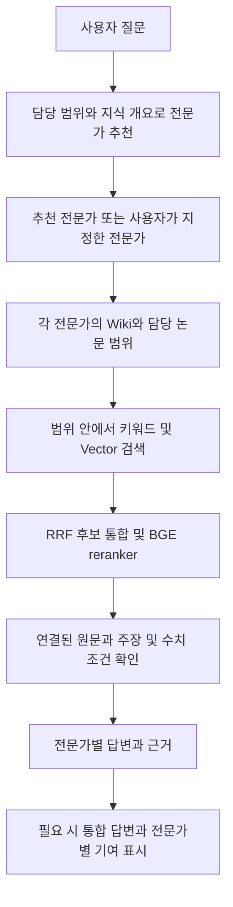

# Evidence Studio 전문가 지식 구축 설계

> **2026-10-13 최신 구현:** 실제 Markdown Wiki·공통 지식 재사용·범위 제한 검색·주기적 lint를 적용했습니다. 현재 실행 방식과 남은 사내 검증 항목은 [Markdown Wiki 운영 안내](MARKDOWN_WIKI.md)를 우선합니다. 아래의 Wiki 엔진/답변 검색이 미구현이라는 설명은 이전 단계의 기록입니다.

전문가는 담당 논문, 핵심 개념, 최근 주목할 연구와 미해결 이슈를 지속적으로 축적하는 연구 파트너입니다. 질문을 받으면 적합한 전문가를 먼저 추천하고, 각 전문가는 자기 담당 지식 안에서 근거를 찾아 답합니다. 기존 PostgreSQL·pgvector 및 원문·주장·수치 DB는 유지하고 그 위에 LLM Wiki 방식의 지식층을 추가합니다. 이 문서는 사내 구현 설계이며 현재 목업에 지식 구축 엔진을 구현하지는 않습니다.

## 적용할 LLM Wiki 방식

### 공통 Wiki와 전문가 특화 Wiki의 병행 · 2026-10-13 보완

논문 → claim → 수치·실험 조건은 전문가와 독립적인 공용 원천 근거로 유지한다. 그 위에 공통 Wiki와 전문가 특화 Wiki를 함께 운영한다. 같은 PDF를 전문가마다 재분석하거나 같은 측정값을 Wiki에 별도 원본처럼 중복 저장하지 않는다.

| 구분 | 내용과 소유 범위 | 생성·갱신 |
|---|---|---|
| 공통 Wiki | 공통 개념·용어, 근거에 연결된 사실·비교. 특정 전문가가 소유하지 않음 | 원천 근거 추가·교정 시 영향받는 블록과 페이지만 갱신 |
| 전문가 특화 Wiki | 한 전문가가 소유하는 여러 주제 페이지. 해당 분야의 핵심 지식·최근 이슈·상충 결과·FAQ·지식 공백 | 담당 범위 변경, 참조한 공통 지식 변경, 질문에서 드러난 지식 공백을 기준으로 부분 갱신 |

전문가 생성은 저장한 분류와 수동 포함/제외 규칙으로 담당 근거를 정한 뒤 기존 공통 Wiki의 관련 블록을 연결하고, 그 전문가의 관점에서 종합이 필요한 소수의 개요·이슈 페이지만 작성하는 순서다. 초기 생성 이후에도 근거 ID·revision의 의존 관계를 따라 변경분만 반영한다. 질문 빈도는 갱신 우선순위를 높이지만 사실성이나 신뢰도의 근거가 되지 않는다.

전문가 Wiki의 각 사실은 공통 Wiki를 경유하더라도 최종 claim·수치·조건·원문 revision까지 추적한다. 공통 블록의 근거가 모두 담당 범위에 있을 때 그대로 재사용하고, 외부 범위가 섞인 문장은 제외하거나 허용된 근거로 다시 종합한다. 다른 전문가 Wiki는 탐색 후보와 참고 관점으로 활용할 수 있지만 원천 증거로 간주하지 않는다. 최종 답변 전에 담당 범위와 원문 근거를 검증하고 순환 인용을 막는다.

전문가 삭제 시 해당 전문가의 특화 Wiki와 연결·갱신 대상도 함께 제거한다(실행 취소를 위해 보관 상태로 둘 수 있음). 공통 Wiki, 논문·claim·수치와 다른 전문가의 Wiki는 유지한다. 기존 답변은 당시 근거 snapshot을 유지한다. 공통 Wiki의 최초 작성 전문가 정보는 출처 메타데이터이며 소유권이나 검색 범위가 아니다.

현재 로컬 구현의 `knowledge_pages` 41개는 공통 근거 페이지 성격이며 `expert_knowledge_pages`가 담당 범위 안의 재사용 연결이다. 별도의 전문가 특화 종합 Wiki 저장·생성 엔진은 아직 구현하지 않았다. 이번에는 삭제 시 연결 해제, 추천·검색 제외, 공통 본문·근거 보존 및 실행 취소만 구현했다. 이 이중 구조를 실제 구현한 것으로 표시하지 않는다.

### 독자가 보는 지식 구조

핵심 지식은 '실험 결과 / 저자 해석'이라는 종류별 제목 대신 무엇을 알 수 있는지 설명하는 문장으로 작성합니다. 예를 들어 'Retention time은 시료와 측정 온도를 함께 확인해야 비교할 수 있다' 아래에 보고된 값과 적용 범위를 연결합니다. 보고된 결과를 보편적인 사실로 확대하지 않고, 검증되지 않은 가능성과 확인되지 않은 조건은 별도 영역에서 설명합니다. 출처 유형은 원문 근거를 펼쳤을 때 claim별로 표시합니다.

독립 지식 노트 탭은 Wiki와 같은 내용을 반복하므로 제거합니다. `지식 개요`는 주요 지식 3개·미확인 내용 2개와 주목할 논문, `Wiki`는 주제별 내용·근거·갱신 이력, `담당 논문`은 출처 검색을 제공합니다. 논문별 노트는 공통 claim·수치를 묶는 내부 파생 보기로 재사용하며 별도 분석 경로를 만들지 않습니다.

논문이 늘어도 개요를 계속 확장하지 않습니다. Wiki 핵심 지식은 3개씩, 미확인 내용·FAQ·준비 중 자료와 근거 상세의 주장은 2개씩, 주제·논문·버전 목록은 5개씩, 변경 항목은 3개씩 표시합니다. 근거와 운영용 시연은 접어 두고 검색·페이지 이동으로 나머지를 탐색합니다. 주요 항목은 사내 구현 시 주제 대표성·사용자 관심·최근 근거 변경을 고려해 선정하되 질문 빈도를 진실성이나 논문 품질 점수로 사용하지 않습니다. 현재 목업은 고정 주제 순서를 사용하며 중요도 모델은 없습니다.

[Karpathy의 LLM Wiki 원문](https://gist.github.com/karpathy/442a6bf555914893e9891c11519de94f)은 완성된 제품이나 단일 라이브러리가 아니라, 자료를 읽으며 연결된 지식 페이지를 작성하고 계속 갱신하는 패턴입니다. Evidence Studio에서는 이 패턴을 전문가별 지식 축적에 적용하되 기존 검색과 근거 DB를 함께 사용합니다.

Wiki에는 개념 설명, 논문 간 비교, 최근 이슈, 주목할 논문과 선정 이유, 아직 알 수 없는 내용을 정리합니다. 정확한 수치·단위·부등호·실험 조건과 인용은 기존 DB에서 확인합니다. [WiCER 연구의 초록](https://arxiv.org/abs/2605.07068)은 문서를 Wiki로 압축할 때 중요한 정보가 누락될 수 있음을 보고합니다. 이를 고려해 원문을 보존하고 조건 비교·예외·반례가 살아 있는지 평가합니다. 해당 연구의 벤치마크 수치를 사내 성능 보장으로 사용하지 않습니다.

## 저장소와 전문가 지식의 관계

| 계층 | 저장하는 것 | 재사용 방식 |
|---|---|---|
| 기존 근거 DB | 논문, 문서 버전, 원문, 주장, 수치·조건, 검색 단위·임베딩 | 동일 논문·문서 버전은 한 번 처리하고 공유 |
| 공통 지식 자료 | 논문별 요약 카드, 개념 설명, 검증된 원문으로 연결되는 지식 블록 | 관련 전문가가 같은 자료를 참조 |
| 전문가 지식 | 담당 논문 집합, 그 범위에 맞춘 개요·이슈·비교·주목할 논문·지식 공백 | 전문가의 설정과 담당 논문 버전에 맞춰 유지 |

논문 원본을 전문가별로 복제하거나 전문가마다 별도 Vector DB를 만들지 않습니다. 동일 논문이 DRAM과 Reliability 양쪽에 관련되면 두 전문가의 담당 논문에 모두 포함될 수 있습니다. 각 전문가의 답변 검색 범위는 자신에게 편입된 활성 논문으로 제한합니다. 팀 공용 저장소와 전문가별 지식 범위는 별개이며 workspace를 추가하지 않습니다.

공통 Wiki 페이지를 재사용할 때도 범위를 지킵니다. 본문 블록마다 근거 논문 ID를 연결하고, 해당 블록의 근거가 모두 담당 논문에 포함될 때 그대로 재사용합니다. 담당 범위 밖 근거가 섞인 종합 문장은 그대로 전달하지 않고 제외하거나 허용된 근거만으로 다시 작성합니다. 페이지 이름에 DRAM이 들어 있다는 이유만으로 페이지 전체를 허용하지 않습니다.

## 최초 분석에서 공통 분류를 만들고 재사용

논문을 처음 분석할 때 미리 정의한 공통 category로 분류합니다. 이 분류는 전문가가 생기기 전에도 존재하는 논문 메타데이터이며 workspace나 사용자 공간을 뜻하지 않습니다. 전문가와 category를 일대일로 묶지 않고, 전문가가 여러 분류와 세부 담당 조건을 조합해 지식을 구성하도록 합니다.

Report AI의 활성 코드에는 메모리 관련성 분류와 다섯 가지 독립 분류 축이 이미 있습니다. 다음 어휘를 초기안으로 재사용합니다. 처음에는 platform과 focus를 중심으로 활용하고 나머지 축은 확실한 정보가 있을 때 채웁니다. 모든 논문에 모든 값을 강제로 부여하지 않습니다.

| 분류 축 | 초기 값 예시 | 쓰임 |
|---|---|---|
| `platform` | DRAM, NAND, SRAM, HBM, MRAM, RRAM, PCM, Ferroelectric Memory | 담당 메모리 종류 |
| `application` | CIM/PIM, Neuromorphic, CAM | 메모리 활용 방식 |
| `layer` | Material/Physics, Device/Cell, Process/Integration, Circuit/Array, Architecture/System, Packaging/Interconnect | 연구가 기여하는 기술 계층 |
| `focus` | Performance/Efficiency, Reliability/Variability, Scaling/Density, Mechanism/Characterization | 해결하려는 연구 문제 |
| `method` | Experiment/Measurement, Modeling/Simulation, Review/Perspective | 검증·분석 방식 |

플랫폼·응용·연구 초점을 하나의 배타적인 트리에 섞지 않습니다. 한 논문에 DRAM과 HBM, Reliability와 Performance 등이 함께 붙을 수 있습니다. 대표 태그는 목록 표시를 위한 값이며 나머지 태그의 검색 자격을 없애지 않습니다. 내부 키와 영어 대표 표기는 고정하고 한국어·약어 별칭은 기존 용어 사전으로 연결합니다.

Report AI의 `MEMORY_CORE`, `MEMORY_RELATED`, `GENERAL_SEMICONDUCTOR` 구분도 메모리 관련성 메타데이터로 활용합니다. 추출 실패·서지정보 부족·분류 미확정은 주제와 별도 상태로 보존합니다. `GENERAL_SEMICONDUCTOR`나 태그 없음만으로 논문을 폐기하지 않습니다. 향후 Process·Packaging 등 전문가에게 관련될 수 있습니다.

분류 비용은 다음 순서로 줄입니다.

1. 정리된 제목·초록에 Report AI의 사전·패턴과 약어 예외를 적용합니다. 제목의 신호를 더 크게 반영하고 초록의 단순 배경 언급을 구분합니다. 분류에 사용한 표현·위치를 함께 남깁니다.
2. 명확하면 결과를 저장합니다. 추출 오류는 분류 모델로 추측해 메우지 않고 추출 검토로 보냅니다. 메타데이터는 정상인데 규칙이 애매한 경우에만 논문 카드와 필요한 본문 일부를 사내 LLM으로 검토합니다. 카드 생성 시 LLM을 이미 호출한다면 같은 구조화 응답에 태그 후보와 이유를 함께 받아 중복 읽기를 줄입니다.
3. 허용된 태그·근거를 검증한 뒤 저장하고 남은 모호함만 관리자에게 보냅니다. 등록되지 않은 태그는 임의 추가하지 않고 새 분류 제안으로 남깁니다. 규칙 점수와 LLM 판단 점수를 정확도 확률로 취급하지 않습니다.
4. 입력 fingerprint와 taxonomy·분류기·프롬프트 버전이 같으면 기존 결과를 사용합니다. 분류 규칙만 바뀌면 저장된 제목·초록·카드로 영향받는 항목을 재분류하고 OCR·문서 임베딩은 다시 만들지 않습니다. 수동 교정은 자동 결과와 분리해 보존합니다.

Report AI에서 확인한 것은 규칙 기반 분류, 약어 예외, 다중 축, 입력 fingerprint와 버전에 따른 재사용입니다. 위 LLM 보완과 전문가 편입은 Evidence Studio에 제안하는 확장입니다. 성능·정확도를 이번 정적 코드 검토로 검증한 것은 아닙니다. 구체적인 코드와 회귀 사례는 [참조 기록](REPORT_AI_REFERENCE.md#논문-분류에서-재사용할-부분)에 정리했습니다.

전문가 구성 예시는 다음과 같습니다. 표의 조건은 초기 후보를 모으는 기준이며, 최종 소속은 전문가의 담당 범위와 포함·제외 규칙으로 확정합니다.

| 새 전문가 | 공통 분류 조합 | 추가로 좁힐 조건 예시 |
|---|---|---|
| DRAM 전문가 | platform: DRAM | 메모리 관련성, 관리자 제외 항목 |
| DRAM Reliability 전문가 | platform: DRAM + focus: Reliability/Variability | retention, disturbance 등 세부 범위 |
| HBM Packaging 전문가 | platform: HBM + layer: Packaging/Interconnect | bonding, interconnect 등 세부 범위 |
| Memory Reliability 전문가 | 여러 memory platform + focus: Reliability/Variability | 플랫폼 간 조건 비교 |

관리자는 이름·전문가 개요를 입력하고 명시적으로 분류 추천을 요청할 수 있습니다. 개요는 전문성·연구 관점·도움을 줄 수 있는 질문을 소개하는 글이며 편입 규칙 자체가 아닙니다. 추천된 분류는 관리자가 확인·수정합니다. 새 전문가는 모든 축을 전체 선택으로 시작하고 필요 없는 값을 해제합니다. 전체 선택은 해당 축의 제한 없음(미기재 포함), 선택 없음은 자동 편입 없음으로 구분합니다. 기존 전문가의 선택값은 유지합니다. 같은 축의 선택 값은 기본 OR, 축 사이는 기본 AND로 표현하되 복합 범위는 버전이 있는 명시적 규칙으로 저장합니다. 예를 들어 `(DRAM OR HBM) AND Reliability`를 설명 가능한 조건으로 보여줍니다. 미기재 값은 부정 판정이 아니므로 일부 축이 비어 있는 관련 논문도 보완 후보로 남깁니다.

공통 분류는 빠른 후보 탐색의 출발점입니다. 새 전문가는 관련 태그의 합집합으로 먼저 후보를 모으고 담당 범위를 검사합니다. 초록·논문 카드의 키워드와 기존 벡터로 미분류·누락 후보를 추가 탐색하고, 애매한 항목만 검토합니다. 이 보완 탐색은 지식 구축 단계에서 수행하며, 답변 단계에서는 최종 편입된 담당 논문만 검색합니다. 새 세부 전문가 하나 때문에 전체 taxonomy를 다시 만들지 않습니다. 기존 축으로 표현하기 어려운 연구 분야가 반복되면 분류 버전을 올리고 필요한 항목만 보강합니다.

## 논문이 들어올 때 지식을 쌓는 순서

1. 기존 수집 경로에서 PDF를 처리하고 원문·주장·측정값·조건과 임베딩을 저장합니다. 같은 입력·모델·전처리 버전의 작업은 재실행하지 않습니다.
2. 공통 taxonomy의 대분류·다중 태그를 저장하고 논문별로 짧은 요약 카드 하나를 만듭니다. 주제, 연구 대상, 주요 결과, 한계, 발행 시점과 근거 ID를 포함합니다. 규칙 분류로 불명확한 부분은 카드 생성 결과를 재사용해 보완합니다.
3. 공통 분류로 관련 전문가 후보를 좁히고 담당 범위·포함 및 제외 기준과 논문 카드·기존 검색 결과를 비교합니다. 명확한 논문은 자동 편입하고 애매한 경우만 관리자 검토 목록에 보냅니다. 매 논문을 모든 전문가에게 각각 LLM으로 판정시키지 않으며, 추가 판정이 필요하면 관련 후보만 묶어 처리합니다.
4. 새 논문이 영향을 주는 개념·비교·이슈 페이지를 찾고 해당 부분만 갱신합니다. 기존 페이지와 새 근거를 함께 읽어 기존 주장과의 관계를 기록합니다.
5. 근거 연결, 숫자·단위, 담당 범위, 원문 검증 상태를 확인한 뒤 새 지식 버전을 공개합니다. 판단이 불명확한 해석·충돌은 검토 대상으로 남깁니다.

분류는 여러 전문가에 중복 편입할 수 있습니다. 자동 분류의 판단 점수와 이유를 기록하되 모델 점수를 곧바로 정확도 확률로 해석하지 않습니다. 자동 편입 기준은 실제 논문의 포함·제외 사례로 보정합니다. 관리자의 명시적 포함·제외 결정은 재분류가 덮어쓰지 않습니다. 담당 전문가가 없는 논문은 공용 라이브러리에 남고, 새 전문가가 생기면 다시 후보가 될 수 있습니다.

## 새 전문가를 빠르게 만드는 과정

관리자는 이름과 전문가 개요를 작성하고 논문 분류 조합을 설정합니다. 개요 수정만으로 편입 조건은 바뀌지 않습니다. 포함·제외할 주제와 대표 논문은 선택적으로 보충할 수 있습니다. 모든 논문을 한 편씩 지정하거나 답변 모델을 새로 학습시키는 작업은 요구하지 않습니다.

| 단계 | 수행할 작업 | 리소스를 줄이는 방법 |
|---|---|---|
| 분야 정의 | 이름·전문가 개요에서 공통 분류 조합을 추천하고 관리자가 확인한 조합·포함·제외 규칙을 저장 | 한 번 생성하고 설정 버전에 맞춰 재사용 |
| 담당 논문 확보 | 공통 분류로 초기 후보를 찾고 카드·키워드·기존 벡터로 누락 후보를 보완한 뒤 편입 판단 | PDF 재처리와 전체 논문별 LLM 호출을 피함 |
| 기존 지식 연결 | 편입된 논문의 카드와 범위에 맞는 공통 지식 블록 연결 | 이미 만들어진 설명·근거를 재사용 |
| 초기 전문가 구성 | 분야 개요, 핵심 개념, 주요 논문, 최근 이슈, 지식 공백 구성 | 소수의 개요 페이지부터 작성; 입력·출력 토큰과 페이지 수에 예산 적용 |
| 점진적 보강 | 필요한 세부 비교·쟁점 페이지를 추가 | 새 근거·변경·실제 질의에서 드러난 공백이 있을 때만 생성 |

담당 논문 집합을 확정하는 단계와 모든 논문을 Wiki로 깊게 종합하는 단계를 분리합니다. 담당 논문으로 편입된 자료는 상세 Wiki가 아직 없어도 원문 검색으로 사용할 수 있습니다. 초기 개요가 완성되면 현재 포함된 논문 수·지식 기준 시점과 함께 먼저 사용할 수 있게 하고, 지식이 없는 하위 분야는 명시합니다. 초기 후보만 처리한 상태를 전체 분야의 구축 완료로 표시하지 않습니다. 상위 후보의 빠른 준비와 별도로 주제·분류 색인을 순차 점검해 관련 논문 누락을 줄입니다.

새 전문가 생성 시에는 기존 OCR·파싱·claim 추출·문서 임베딩을 재사용합니다. 프로필 임베딩이나 새로 작성한 Wiki 페이지 색인이 필요할 수 있지만 기존 논문 전체를 다시 임베딩하지 않습니다. 관련 논문이 없다면 자료 부족으로 남기며 다른 분야의 자료로 지식을 채우지 않습니다. 전문가마다 상시 실행 프로세스나 모델 사본도 두지 않습니다. 동일한 사내 LLM·embedding·reranker 서비스를 설정과 지식 범위만 바꾸어 공유합니다.

초기 Wiki 조회는 제목·주제·요약·본문 키워드 색인과 원문 검색 결과에서 지식 페이지로 이어지는 링크를 활용합니다. Wiki 전용 임베딩을 처음부터 전 페이지에 추가하지 않습니다. 실제 질의 평가에서 필요성이 확인된 경우에만 변경된 지식 페이지를 별도로 임베딩합니다. 관련 논문 전체가 준비되어도 Wiki는 개요와 필요한 페이지부터 작성하며, 모든 분류 조합의 Wiki를 미리 생성하지 않습니다.

## 질의와 전문가 협업

추천 단계는 전문가의 담당 분야·개요·다룰 수 있는 질문·지식 범위를 사용합니다. 모든 분야의 원문을 먼저 검색한 뒤 답변에 전문가 이름만 붙이지 않습니다. 추천 이유와 담당 분야를 보여주고 사용자가 전문가를 바꿀 수 있게 합니다. 자동 진행과 직접 지정 모드 모두 동일한 지식 범위 규칙을 적용합니다.

개요와 동향 질문은 먼저 전문가 Wiki에서 정리된 맥락을 활용합니다. 정확한 주장·비교·수치 질문은 담당 논문의 원문·구조화 데이터까지 조회합니다. Wiki가 부족하면 동일 담당 범위의 원문을 더 찾고, 범위 밖의 지식이 필요하면 다른 전문가를 추가로 추천합니다. 적합한 전문가나 근거가 없으면 그 이유를 알리며 공용 전체 검색으로 조용히 전환하지 않습니다.

검색 후보를 만드는 시점부터 전문가의 활성 담당 논문 ID로 제한합니다. Vector 결과를 공용 전체에서 적게 뽑은 뒤 마지막에 거르는 방식으로 대체하지 않습니다. 명시적으로 선택한 논문이 있으면 담당 논문과의 교집합만 사용합니다. 교집합이 없으면 적합한 다른 전문가를 안내합니다. 여러 전문가를 선택해도 각자 자기 범위에서 검색하고, 통합 단계는 그들이 제출한 근거만 종합합니다.

답변에 참여 전문가, 실제 인용 논문, 사용한 지식 페이지 버전과 기준 시점을 연결합니다. Wiki의 종합 해석과 논문 저자의 주장은 구분하며, Wiki 자체만 인용해 원문 근거가 있는 것처럼 표시하지 않습니다.

## 최근 이슈와 주목할 논문

최근 발행된 논문, 최근 들어온 논문, 오래되었지만 중요한 기반 논문을 구분합니다. 주목할 논문은 발행 시점, 연구 주제와의 관련성, 기존 설명에 대한 새 근거·반례, 여러 논문에서 반복되는 이슈, 관리자의 중요 표시를 바탕으로 선정 이유를 남깁니다. 단순히 업로드가 최신이거나 reranker 점수가 높다는 이유로 학계에서 인기 있는 논문이라고 단정하지 않습니다.

현재 입력이 사내에 모인 PDF라면 동향의 범위는 '등록된 담당 논문 기준'입니다. 학계 전체의 화제성·인용 추세를 평가하려면 별도로 검증 가능한 외부 메타데이터가 필요하며 현재 단계에서 수집 서비스를 만들지 않습니다. 이슈 페이지에는 기준 기간, 지식 갱신 시점, 포함 논문, 반대 근거와 미확인 부분을 기록합니다. 근거가 없는 최근 이슈는 생성하지 않습니다.

## 기존 DB를 유지하는 최소 확장

기존 테이블 이름과 원문·주장·측정값·임베딩의 구조는 유지합니다. 공통 분류에는 기존 `topics`, `paper_topics`를 사용합니다. `topics`는 축·안정적인 태그 키·정의·taxonomy 버전을, `paper_topics`는 논문별 다중 태그·분류 방식·점수·이유·입력 fingerprint·분류기 버전·검토 상태를 보존하도록 확장합니다. 메모리 관련성과 분류 준비 상태는 논문 메타데이터에 별도로 둡니다. 자동 판정과 수동 교정의 출처를 구분합니다.

`expert_topics`는 공통 분류와 전문가의 연결을, `expert_category_versions`는 AND/OR·포함·제외 조건과 프로필 버전을 보존합니다. `expert_papers`는 기존의 단순 우선순위 의미에서 담당 지식 범위를 정하는 관계로 역할을 명확히 합니다. 편입·검토 대기·제외 상태, 분류 이유·방식, 관리자 수정, 소속 변경 버전을 위한 필드만 확장합니다. 가중치는 담당 범위 내부의 주요 논문 표시로 사용할 수 있습니다. 담당 논문 집합의 변경은 버전과 이력으로 남겨 과거 답변의 범위를 추적합니다.

Wiki 저장 모델은 다음 두 종류로 제한합니다. 공통 근거 DB에는 기존 claim–measurement 관계를 명시하는 `claim_measurements`를 추가하며, 불변 근거 revision·FK 규칙은 [DB 설계](DATABASE_PLAN.md#claim부터-답변까지의-연결-계약)를 따릅니다. 전문가별 claim 복제나 독립 PDF 분석 경로는 만들지 않습니다. 실제 DDL은 사내 구현 단계에서 정합니다.

| 추가 저장 모델 | 내용 |
|---|---|
| `knowledge_pages` | 논문 카드·개념·비교·이슈·분야 지식 개요, 공통 또는 특정 전문가 소유, 페이지와 revision ID, 근거를 연결할 본문 블록, 상태·기준 시점·생성 모델·정책 버전·내용 해시 |
| `knowledge_links` | 특정 페이지 revision·본문 블록에서 문서·claim·measurement·condition value·evidence span 또는 다른 페이지의 불변 revision으로 이어지는 유형별 FK 연결. 대상 하나 CHECK·중복 방지 및 역방향 변경 추적에 사용 |

본문은 Markdown 또는 구조화된 블록으로 표현하되 DB에 저장한 버전이 기준입니다. Markdown 내보내기는 인수인계와 열람용으로 제공할 수 있습니다. 다중 사용자가 각자 파일을 수정하는 별도 원본 저장소를 만들지 않습니다. 페이지 링크와 원문 ID는 실제 대상 존재 여부를 검증합니다.

전문가 설정 버전은 `expert_category_versions`, 수집·지식 구축 작업 상태와 재시도는 기존 `ingestion_jobs`, 관리자 교정은 `review_events`, 답변에 사용한 전문가·근거·지식 버전은 `answer_runs`, `answer_experts`, `citations`에 연결합니다. 전문가별 독립 DB·Graph DB·전체 Wiki 복제본을 추가하지 않습니다. 핵심 근거 DB만으로도 답변할 수 있고 Wiki는 재구축 가능한 지식층으로 둡니다.

## 변경분만 갱신하는 운영

- 입력 문서·추출·모델·정책 버전과 내용 해시로 작업 키를 만들어 중복 수행을 막습니다. 같은 논문을 여러 전문가가 쓰더라도 논문 카드 생성은 한 번만 수행합니다.
- 새 논문이나 교정이 들어오면 `knowledge_links`의 의존 관계를 따라 영향을 받는 페이지와 분야 지식 개요만 갱신합니다. 관련 주제·유사 주장 후보를 먼저 좁히고 전체 논문 쌍을 LLM으로 비교하지 않습니다.
- 변경 요청을 짧은 배치로 묶어 같은 페이지의 반복 재작성을 줄입니다. 작업당 입력 토큰·페이지 수·모델 호출·동시 실행량을 제한하고 예산을 넘는 보강은 이후 작업으로 넘깁니다.
- 캐시는 원문·페이지·전문가 설정·담당 논문 버전과 생성 규약을 포함해 구분합니다. 기존 지식과 인용을 보존하고 새 revision의 검증이 끝난 뒤 현재 버전을 전환합니다. 같은 페이지를 동시에 갱신하면 버전 충돌을 감지합니다.
- 논문이 제외되거나 근거가 교정되면 의존하는 Wiki를 갱신 필요 상태로 표시합니다. 갱신 전에는 문제가 있는 블록을 답변에 쓰지 않고 현재 유효한 담당 논문의 원문 근거를 사용합니다.
- 질의가 드러낸 지식 공백은 보강 후보로 기록할 수 있습니다. 사용자 대화를 자동으로 공용 Wiki에 복사하지 않습니다. 공용 페이지는 허용된 논문 근거로 작성하고, 비공개 질문·연구 가설·답변의 내용을 공유 지식으로 자동 승격하지 않습니다.

Wiki의 지속적 축적은 외부 지식의 갱신입니다. 매번 LLM을 fine-tuning하는 작업으로 설계하지 않습니다. 비용 절감은 기존 결과 재사용·증분 갱신·입력 예산으로 달성하며, 특정 구축 시간이나 비용을 측정 전 보장하지 않습니다.

## 반복 질문을 이용한 지식 점검

공유된 질문을 기간·주제별로 묶어 반복 질문과 지식 공백의 점검 우선순위를 정합니다. 질문 횟수는 주장 검증이나 논문 품질 점수가 아닙니다. 관련 담당 논문의 공통 claim·수치·근거를 조회해 FAQ를 보강하고, 새로운 근거가 없으면 점검 시각만 기록하며 본문 revision과 갱신 시각은 유지합니다. 비공개·삭제 질문을 공용 집계와 페이지에 포함하지 않습니다. 실제 자동 작업은 같은 주제의 요청을 합쳐 처리하며 질문마다 전체 PDF나 Wiki를 재분석하지 않습니다.

현재 목업은 가상 집계와 세션의 공개 질문을 사용하고, 버튼으로 점검을 시연합니다. 실제 의미 군집화·자동 작업 실행은 사내 구현 범위입니다. [시스템 점검](SYSTEM_REVIEW.md)의 보완 반영 결과와 [DB 설계](DATABASE_PLAN.md)의 근거 revision·선택 snapshot 계약을 사내 구현 기준으로 사용합니다.

## 구현과 평가 순서

1. 기존 근거 DB와 검색 서비스를 유지하면서 Report AI의 공통 분류 어휘·규칙·회귀 사례를 이관 기준으로 삼습니다. 담당 논문 관계, 자동 편입과 애매한 항목 검토를 연결합니다.
2. 논문 카드와 소수의 분야 지식 개요·이슈 페이지부터 추가합니다. 신규 전문가가 같은 원문·임베딩·카드를 재사용하는지 검증합니다.
3. 개요 질문과 수치·조건 질문을 나눠 평가하고, 필요한 개념·비교 페이지와 변경 영향 갱신을 늘립니다.

최소 검증 항목은 다음과 같습니다.

- 새 전문가 생성 전후 OCR·기존 문서 임베딩의 추가 실행 횟수, 새 LLM 호출 수·입출력 토큰, 최초 사용 가능 시점, 전체 분류 완료 시점을 각각 측정합니다.
- 전문가 담당 범위 밖 원문·Wiki 근거가 답변에 섞이지 않는지, 명시적으로 선택한 논문 범위가 지켜지는지 확인합니다.
- 자동 편입의 오분류와 관련 논문 누락, 관리자 검토 비율을 측정합니다. 담당 범위를 바꾸거나 전문가를 새로 만들 때 미분류 논문도 후보가 되는지 확인합니다.
- 질문에 필요한 숫자·부등호·조건·반례가 Wiki 압축에서 누락되지 않는지 원문 기반 질문과 대조합니다. 근거 없이 채운 문장과 잘못 연결된 인용을 검사합니다.
- 새 논문 한 편이나 교정 한 건이 영향을 받는 페이지만 갱신하는지, 제외한 근거·오래된 요약·비공개 대화가 새 답변에 재등장하지 않는지 확인합니다.

원문 전체를 전문가마다 다시 처리하는 방식과 비교해 실제 비용·지연·답변 품질을 측정한 후 예산과 분류 기준을 확정합니다. 초기에는 원문 근거 재사용과 담당 범위 준수를 우선하고, 성능 측정 없이 대규모 그래프 추출이나 전체 Wiki 일괄 생성을 도입하지 않습니다.

## 목업에 반영한 화면

전문가 카드에는 담당 분야, 담당 논문 수, 최근 주목할 논문·이슈, 지식 기준 시점을 표시합니다. 질의에는 추천 전문가와 추천 이유, 답변에는 실제 참여한 전문가와 그 전문가가 사용한 근거를 표시합니다. 관리자는 전문가 생성 시 범위를 정하고 자동 분류 결과와 검토가 필요한 논문을 확인합니다. 사용자는 폴더·작업 큐·색인 구축 과정을 볼 필요가 없습니다.

Wiki는 전문가별 주제 페이지로 열어 공통 claim·연결 수치·원문 근거, 마지막 갱신 시각, 변경 이력과 이전 버전을 확인할 수 있습니다. 새 논문 시연은 관련 페이지만 갱신하고, 반복 질문 점검은 확인된 claim으로 FAQ를 보강합니다. 고정 fixture를 사용하는 프런트엔드 동작이며 실제 분석·검색·갱신 서비스는 구현하지 않았습니다.

현재 목업에는 관리자 전문가 생성·분류 조합 추천·편입 결과 미리보기·검토 논문 편입/제외, 팀원의 전문가 지식 개요·노트·주목할 논문·이슈·담당 논문 열람을 반영했습니다. 질문은 추천 이유를 확인하고 전문가를 고른 뒤 각자의 담당 논문으로 구성한 예시 답변으로 이어집니다. 자료가 없거나 선택 논문과 겹치지 않으면 답변을 보류하며 참여 전문가별 사용 근거를 표시합니다.

이는 `knowledge.ts`의 가상 분류와 공통 claim·수치의 파생 보기를 재사용하는 화면 시연입니다. Wiki 제목과 연결 설명은 목업용 편집 문구이며 본문의 claim 요약·수치·조건은 공통 근거를 참조합니다. 새 자료 확인도 가상 논문의 연결 변화를 보여줄 뿐 실제 OCR·분류 모델·embedding·검색·reranker·LLM·Wiki 엔진을 실행하지 않습니다. 본문의 사내 시스템 설계가 구현 완료된 것은 아닙니다. 전문가 설정만 브라우저에 저장하고 서버·DB 구조는 추가하지 않습니다.
