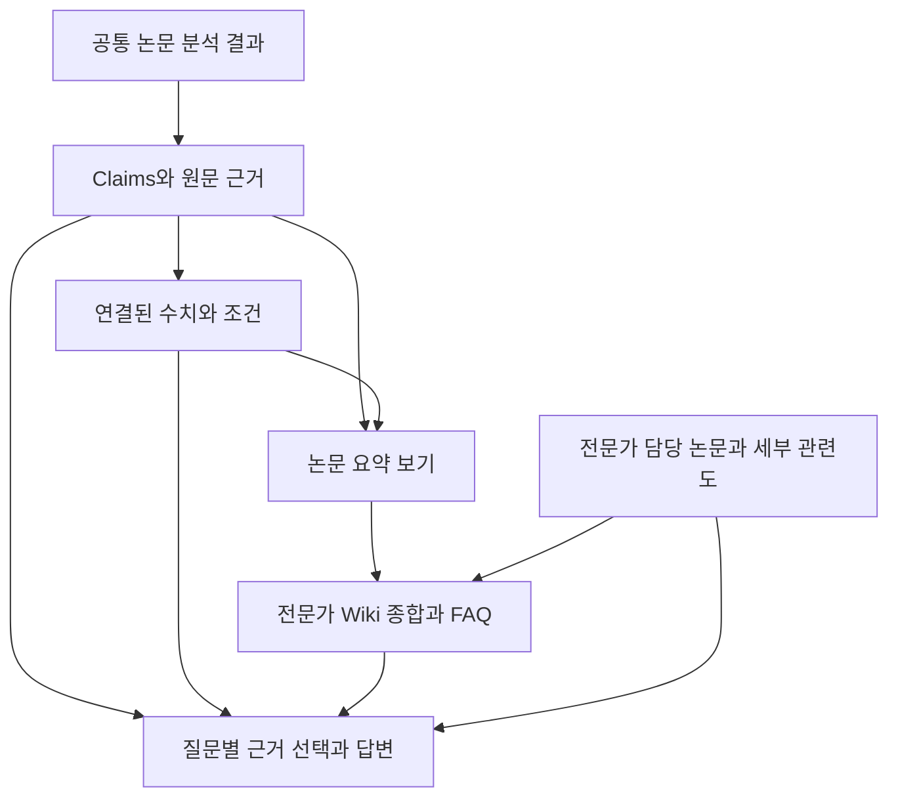

# Evidence Studio 데이터와 지식 흐름 점검

2026년 10월 13일 갱신: 실제 PDF 41편·164페이지·712개 검색 구간을 SQLite에 적재하고 41편 전부를 직접 읽어 claim 133개, measurement 141개, 조건 항목 334개, Wiki 본문 41개를 저장했다. 9명의 전문가가 64개의 연결로 공통 Wiki를 재사용한다. 선택한 claim에 직접 연결된 수치·조건·원문만 반환하며 Wiki는 PDF를 다시 분석하지 않는다. 모든 claim이 Wiki에 연결되고 담당 범위 위반·FK 위반은 0건이다. [실제 시범 검증·한계](LOCAL_PILOT.md)와 [목업 비교 점검](PILOT_PARITY_REVIEW.md)을 참조한다. 외부 LLM, vector 검색, SSO 및 운영용 PostgreSQL 통합은 수행하지 않았다.

아래는 **기존 가상 목업**의 점검 기록이다. 공통 claim·measurement는 논문 상세·답변·Wiki에 연결되어 있으나 fixture 및 브라우저 상태이며 실제 SQLite 시범과 섞이지 않는다.

## 기존 목업 데이터 사용 현황

초기 가상 논문 6편에는 claim 12개, measurement 6개, evidence span 12개, claim relation 1개가 있다. 이 중 원문 대조가 필요한 가설 1개는 답변과 Wiki의 확정 근거에서 제외된다. 새 논문 시연의 추가 2편에는 구조화된 주장·수치가 아직 없다.

| 구성 | 현재 목업에서의 사용 | 판정과 남은 범위 |
|---|---|---|
| `papers` | 라이브러리, 전문가 편입, 질문의 명시적 논문 범위, Wiki 소속 | 실제 화면의 범위 제한에 사용한다. JSON fixture이며 DB 조회는 아니다. |
| `claims` | 결과·저자 해석 구분, 원문 대조 상태, 적용 범위, 답변·논문 요약·Wiki 본문 | 질문의 주제·결과/해석 의도·일부 정확 조건으로 claim을 선택한다. 실제 검색·LLM이 아닌 규칙 기반 시연이다. |
| `measurements` | 원문 부등호·단위, 정규화값, 시료·조건, 비교 화면, Wiki의 연결 근거 | 질문별 선택 claim의 연결 수치를 사용하며, 온도·전압 조건이 있으면 그 안에서도 좁힌다. 실제 수치 검색 엔진은 아니다. |
| `evidence_spans` | 논문 원문 인용, Wiki 근거 펼치기, 문서·추출 버전 참조 | 정확한 구절 데이터가 있다. 실제 PDF·좌표로 이동하는 기능은 없다. |
| `claim_relations` | 다른 논문의 주장 연결, 조건 차이에 따른 비교 보류 설명 | 관계 1개의 예시만 사용한다. 관계 추론·검증은 구현하지 않았다. |
| `expert_papers`에 해당하는 상태 | 담당 논문에 한정한 추천 이후의 자료 선택, 검토·제외·준비 중 자료 배제 | 범위 제한과 내부 claim 선택 시연이 작동한다. 실제 hybrid search·BGE reranker와 세부 분야 평가가 남았다. |
| 논문별 파생 보기 | 내부 `knowledgeNotes()`가 공통 claim 요약과 연결된 measurement를 묶어 반환 | 별도 지식 노트 탭은 Wiki와 중복되어 제거했다. 별도 분석·독립 저장소는 만들지 않는다. |
| 전문가 Wiki | 주제별 핵심 지식·미확인 내용, 펼쳐 보는 claim·수치·원문, FAQ, 버전 이력 | 공통 데이터를 재사용한다. 제목·연결 설명은 목업용 편집 문구이며 실제 종합·갱신 모델은 아니다. |
| 질문 빈도 | 가상의 최근 7일 집계에 현재 세션의 공유 질문을 더해 점검 상태 표시 | private·삭제 질문은 집계에서 제외한다. 실제 의미 군집화·기간별 분석·자동 작업 큐는 없다. |
| FastAPI fixture | `/api/papers`와 단일 논문의 읽기 전용 예시 | 가상 자료 API. 추가한 실제 `/api/pilot` 및 DB 상태를 확인하는 `/api/health`와 구분한다. |

코드 근거: [evidence.ts](../src/evidence.ts), [PaperEvidence.tsx](../src/PaperEvidence.tsx), [AnswerEvidence.tsx](../src/AnswerEvidence.tsx), [experts.ts](../src/experts.ts), [knowledge.ts](../src/knowledge.ts), [wiki.ts](../src/wiki.ts), [FastAPI 예시](../backend/main.py).

## 설계에 반영한 연결과 목업 검증

### 질문별 claim과 측정값 선택

이전에는 논문 선택 후 대표 결과·해석을 표시했으나, 이제 `buildContributions`가 담당 논문 안에서 `selectQuestionClaims`를 실행한다. 질문의 주제, 결과/해석 의도, 정확 온도·전압 조건으로 claim을 고른 뒤 연결 measurement를 좁힌다. `captureAnswerEvidence`가 선택 claim·수치·조건·원문·관계를 메모리 snapshot으로 보존하고 화면·복사·근거 노트가 이를 재사용한다. 여러 전문가가 사용한 같은 claim은 본문에서 한 번 표시한다. 전문가는 자신의 선택 ID를 유지한다.

지원하는 고정 사례는 HBM bandwidth와 thermal 구분, DRAM 85 °C와 125 °C 구분, NAND 결과와 mechanism 해석 구분이다. 온도·전압은 일부 정확값만 매칭하며 조건 범위·복잡한 부정·새로운 전문 개념을 이해하는 자연어 검색은 아니다. 목업의 매칭 결과를 실제 검색 성능으로 해석하면 안 된다.

사내 구현은 다음 계약을 [DB 설계](DATABASE_PLAN.md#claim부터-답변까지의-연결-계약)에 따라 보장한다.

1. SSO 권한, 전문가의 활성 담당 논문, 사용자가 선택한 논문의 교집합을 확정한다.
2. 해당 범위의 claim·원문 검색 단위에서 keyword/vector 검색과 reranking을 수행한다. 질문의 지표·조건과 함께 반례·한계·다른 해석도 후보에 포함한다.
3. 선택된 claim ID에서 연결된 measurement·condition·evidence span을 조회한다. 그 논문의 모든 측정값을 일괄 첨부하지 않는다.
4. 답변에 실제 사용한 ID와 revision, Wiki revision, 적용 범위를 `answer_runs`와 인용에 보존한다.

구조화된 claim이 없는 논문은 서지·동향 소개와 정확한 주장·수치 답변의 준비 상태를 구분해야 한다. 현재 목업은 담당 논문이 있더라도 질문에 맞는 확인된 claim이 없으면 답변 확정 버튼을 비활성화한다. 문헌 소개와 근거 기반 답변의 준비 상태를 구분한다.

### 전문가 범위는 논문을 유지하고 claim까지 조회한다

전문가의 자료 범위를 정하는 `expert_papers`는 유지하는 것이 적절하다. 그 안의 모든 claim이 특정 전문가나 질문에 관련된다고 보장되지는 않는다. 예를 들어 한 HBM 논문에 thermal과 interconnect 결과가 함께 있으면, thermal 질문에서는 관련 claim과 실험 조건을 우선 조회해야 한다.

기본 구조는 `expert_papers → claims → claim_measurements → measurements/conditions → evidence_spans`이다. 논문 분류·섹션·claim 적용 범위를 재사용해 세부 관련도를 판정한다. 필요하면 기존 taxonomy를 사용하는 claim별 태그를 점진적으로 추가하되, 전문가 수만큼 claim을 복제하거나 모든 전문가×claim 조합을 사전 생성하지 않는다. 관리자의 claim별 포함·제외는 반복되는 예외가 확인될 때 선택 기능으로 검토한다.

### DB 문서에 claim과 measurement 관계를 명시한다

기존 JSON의 `claim.measurementIds`에 대응하는 `claim_measurements`를 [DB 설계](DATABASE_PLAN.md)의 ER·데이터 사전·연결 계약에 반영했다. 아래 항목은 검토 제안에서 확정 설계로 전환했다.

| 반영 대상 | 확정 설계 |
|---|---|
| `claim_measurements` | claim과 measurement의 다대다 연결, 연결 역할, 근거·버전. 같은 논문·허용된 문서 버전인지 검증한다. |
| `knowledge_links` | 기존 paper·claim·span·page revision 참조에 measurement 및 필요한 condition 참조를 명시한다. 본문 블록별로 연결한다. |
| 근거 버전 | 대상 ID만 남기지 않고 실제 사용한 revision 또는 immutable extraction version을 보존한다. 교정·철회 시 의존 페이지와 답변을 추적한다. |
| 무결성 | 참조 대상 존재, 중복 링크, 잘못된 다른 논문 연결, 버전 혼합을 FK·unique·검증 규칙으로 막는다. 다형 링크는 대상 종류별 FK와 정확히 하나의 대상만 허용하는 CHECK를 사용한다. |

논리 설계에 반영했으며 실제 테이블·DDL·DB 서비스는 만들지 않았다. 사내 구현자는 DB 설계의 불변 revision ID·FK·unique·발행 검증 규칙을 기준으로 구현한다.

### Wiki는 같은 논문의 재분석 경로를 만들지 않는다

claim은 저자가 무엇을 주장했는지 보존하는 공통 사실 기록이고, measurement는 그 주장에 연결된 수치·조건이다. 논문 노트는 이를 읽기 좋게 묶은 파생 보기이며, Wiki는 여러 논문의 관계·해석·공백을 정리하는 파생 지식이다. 같은 수치가 여러 화면에 나타나는 것은 같은 기록의 재사용이다.

이번 목업에서는 `knowledgeNotes`가 `getAnswerClaims`와 연결된 측정값을 읽고, Wiki 블록이 `claimIds`, `measurementIds`, `evidenceIds`를 참조하도록 보강했다. 핵심 지식은 최대 3개 결과 claim의 공통 summary와 비교 조건·적용 범위 설명을 묶는다. 원문에 기재된 결과라는 뜻이며 과학적 보편 사실로 검증되었다는 뜻은 아니다. 저자의 미검증 가능성과 미기재 조건은 별도 블록에 두고 각자의 근거만 연결한다. 구조화된 근거가 없는 새 논문은 준비 상태에 표시하고 핵심 지식·FAQ에 승격하지 않는다.

### 중복 화면 정리와 표시 개수 제한

지식 노트 탭은 Wiki와 같은 claim을 반복해서 보여주므로 제거했다. `지식 개요`는 주요 지식 3개·미확인 내용 2개와 주목할 논문으로 진입점을 제공하고, `Wiki`는 주제별 내용·근거·이력을, `담당 논문`은 출처 탐색을 담당한다. 내부 파생 보기와 공통 근거 DB는 그대로 재사용한다.

핵심 지식의 제목에는 무엇을 알고 있는지 적고, 실험 결과·저자 해석이라는 분류는 펼친 근거의 출처 유형에 둔다. Wiki 핵심 지식은 3개씩, 미확인 내용·FAQ·준비 중 자료와 근거 상세의 주장은 2개씩 표시한다. Wiki 주제·논문·버전 목록은 5개씩, 변경 항목은 3개씩 페이지를 나눈다. 주제와 담당 논문 검색을 제공하며 원문 근거·전체 논문·Wiki 점검·새 논문 시연은 기본적으로 접어 둔다. 전체 데이터는 보존하고 표시량만 제한한다. 목업의 주요 항목은 고정 주제 순서이며 실제 중요도 모델이나 대규모 서버 페이지 조회는 구현하지 않았다.

사내에서는 PDF의 OCR·파싱·claim 추출을 공통 경로에서 수행하고, 노트와 Wiki는 결과를 읽어 구성한다. 새 전문가 생성·질문 빈도 증가·taxonomy 변경만으로 OCR나 기존 문서 embedding을 반복하지 않는다. 원문 누락이나 새 추출 규약 때문에 재분석이 필요할 때만 해당 문서·범위의 공통 분석 작업을 재실행한다. 작업 캐시는 문서 내용 해시, 추출 규약, 모델·정책·원문 버전으로 구분한다.

### 변경 이력과 질문 빈도의 구현 경계

Wiki 목업은 새 논문·담당 논문 변경·본문 변경에 따른 버전을 메모리에서 보존한다. 반복 질문 점검은 확인된 claim으로 FAQ를 보강하고, 이미 반영된 내용은 새 버전을 만들지 않는다. 관련 없는 페이지의 마지막 갱신 시점은 유지한다. 처음 표시되는 시각은 목업 세션에서 Wiki를 구성한 시각이며 실제 논문 분석 시각이 아니다.

현재 Wiki snapshot은 본문과 연결 ID 중심이다. 새 답변 snapshot은 선택 claim·수치·조건·원문 사본까지 보존해 같은 세션에서 원본 fixture가 변해도 답변과 복사 내용이 바뀌지 않는다. 측정값·조건·원문이 같은 ID에서 교정되는 상황을 완전히 추적하는 서버용 이력 구조는 없다. 실제 구현은 연결된 모든 근거의 revision/content hash를 변경 감지에 포함하고, 당시 값과 현재 값을 구분해 조회해야 한다. 모든 담당 근거가 빠진 페이지는 현재 목업 목록에서 사라지며, 폐기된 페이지의 장기 보관·감사 이력 역시 후속 구현이다.

질문 빈도는 갱신 우선순위와 FAQ 구성에 영향을 주되, 주장의 진실성이나 논문의 품질 점수가 되어서는 안 된다. 사내 자동 작업은 일정 기간의 공유 질문을 주제별로 묶고 중복 요청을 합쳐 처리한다. 실제 근거 변경이 없으면 `last_checked_at`만 바꾸고 `last_updated_at`과 본문 revision은 유지한다. private 대화·연구 가설을 공용 Wiki의 학습 자료로 자동 복사하지 않는다.

## 유지할 장점과 검증 범위

원문값·부등호·단위·미기재 조건의 보존, 저자 결과와 해석의 구분, 원문 대조 필요 주장 제외, 전문가 담당 논문과 명시적 선택 범위 제한은 유지한다. 임베딩·reranker·Wiki는 이 공통 근거를 찾고 묶는 역할이며 원문 기록을 대체하지 않는다.

현재 28개 테스트는 기존 ID 연결·조건 보존·분류·전문가 범위·Wiki 재사용·증분 갱신·FAQ 제한에 더해 질문별 선택, 조건 불일치 보류, 해석에 무관한 수치 미첨부, snapshot의 변경 격리, 한 claim의 여러 수치 중 조건 선택을 확인한다. 추가 검증은 핵심 지식과 미확인 해석의 분리, 담당 범위 축소·본문 교정의 새 버전, 12개 결과 claim을 최대 3개씩 묶으면서 연결을 보존하는 경우다. 브라우저에서는 핵심 지식·펼친 근거·검색·FAQ 이력·새 논문 갱신을 확인한다. 실제 검색 품질, DB 인덱스, 동시 갱신, SSO 권한, 재처리 비용은 측정하지 않았다. 실제 시스템 구축은 사내로 이관한다.
